<div align="center">


# WiFi Tic-Tac-Toe

**An ESP32 makes its own WiFi. Join it, pick a fighter, challenge someone in the room.**<br>
**The loser does a dare.**

`NO INTERNET` &nbsp; `NO APP` &nbsp; `NO ACCOUNT` &nbsp; `UP TO 8 PHONES` &nbsp; `4 GAMES AT ONCE` &nbsp; `YOUR OWN NAME` &nbsp; `VANISHING CHAT`


[**Trailer**](#trailer) &nbsp;·&nbsp;
[**Player select**](#player-select) &nbsp;·&nbsp;
[**How to play**](#how-to-play) &nbsp;·&nbsp;
[**Chat**](#chat) &nbsp;·&nbsp;
[**Insert coin**](#insert-coin) &nbsp;·&nbsp;
[**Dares**](#dares) &nbsp;·&nbsp;
[**Cheat codes**](#cheat-codes)

</div>


## Trailer

<div align="center">
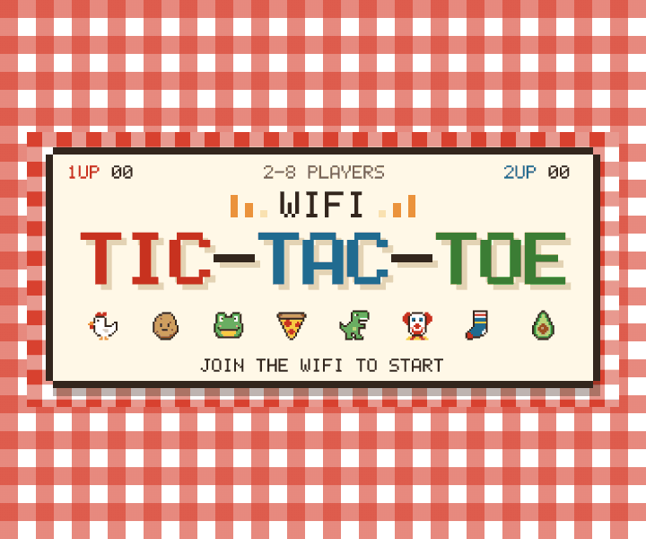

[Watch it as a video](docs/trailer.mp4)

<sub>Recorded from the real game page. The 15-second wait is sped up.</sub>
</div>


## Player select

<div align="center">
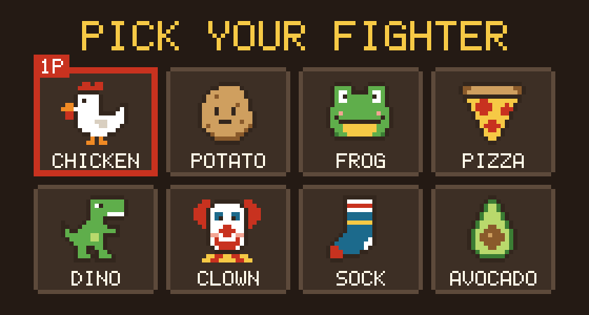
</div>

Your fighter is also your X or O. Nobody else can take it while you are in the game. All eight have the same stats.

### Your name

After picking a fighter you can add your name, up to 12 characters. Leave it empty and you are simply Chicken, or whoever you picked. Your name shows in the lobby, in challenges, in the game and in chat. Two players cannot use the same one, and your phone remembers it for next time.

<div align="center">
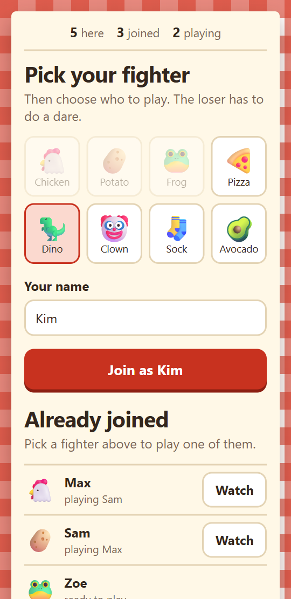
</div>


## How to play

<div align="center">
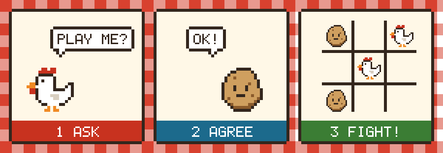
</div>

1. Join the **`Play Tic-Tac-Toe`** WiFi. It has no password.
2. Tap the sign-in notification if the game does not open by itself.
3. Pick a fighter, add your name if you like, and tap **Ask to play** next to someone in the lobby.
4. They tap **Play** or **No thanks**. The game starts only if they say yes.

| Button | What it does |
| :-- | :-- |
| <kbd>Ask to play</kbd> | Challenge someone. You can ask one person at a time. |
| <kbd>Cancel</kbd> | Take the challenge back |
| <kbd>Watch</kbd> | Spectate a game. Challenges still reach you. |
| <kbd>Tick tock...</kbd> | One of eight taunts, shown on your opponent's screen |
| <kbd>Send</kbd> | Chat with your opponent or with everyone. See [Chat](#chat). |
| <kbd>Rematch</kbd> | Go again if both want to. The loser starts. |
| <kbd>Play someone else</kbd> | Back to the lobby |

The scoreboard at the top counts who is **here** (has the page open), who has **joined** (picked a fighter) and who is **playing**.

<div align="center">
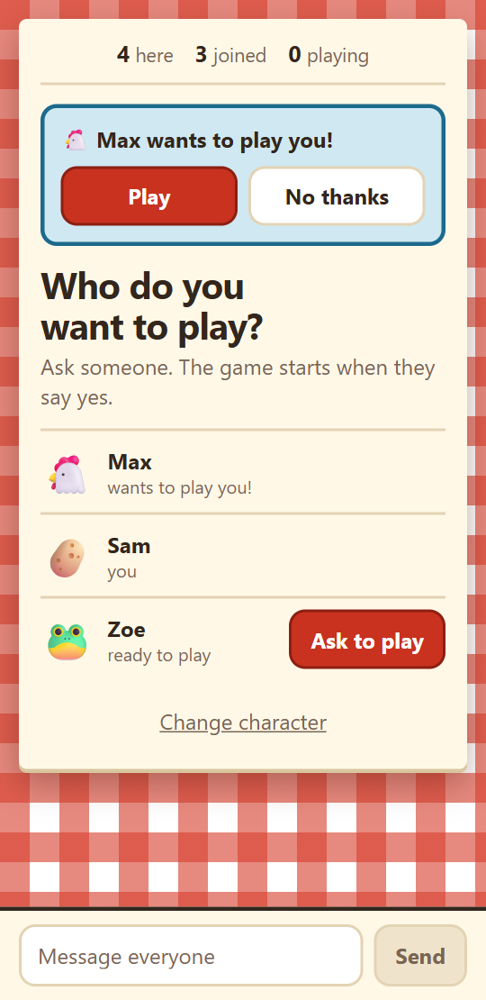
&nbsp;
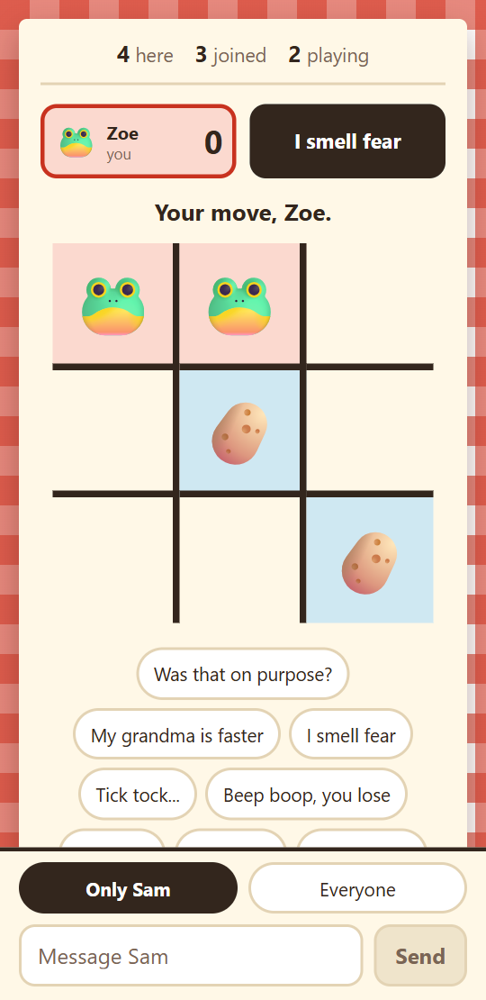
&nbsp;
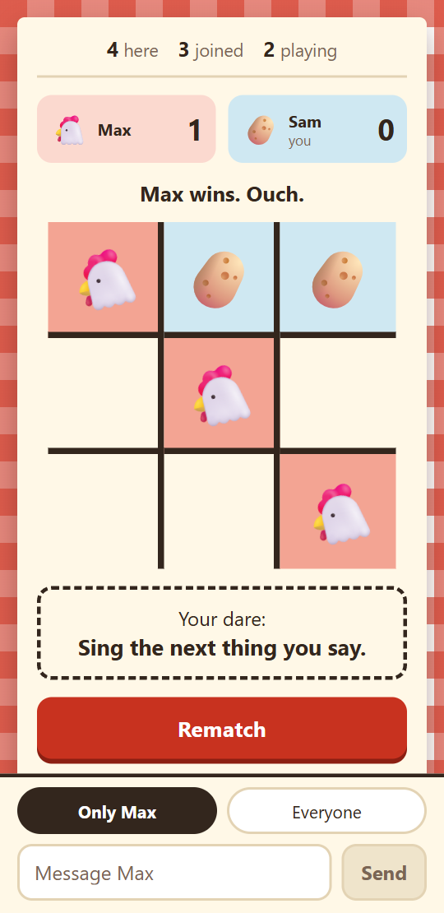
</div>

> [!WARNING]
> Vanish for 20 seconds (a locked screen counts) and you lose your fighter and your game.

### Chat

Type in the box at the bottom of the screen. There are two chats:

| Chat | Who reads it |
| :-- | :-- |
| **Only (opponent)** | Just the player you are playing. Watchers do not see it. |
| **Everyone** | Everybody with the page open, in the lobby or in any game |

In a game you start in the first one, and two buttons above the box switch between them. Messages from the global chat are marked *to everyone*. Outside a game there is only the global chat. You need a fighter to write, but guests can read it.

<div align="center">
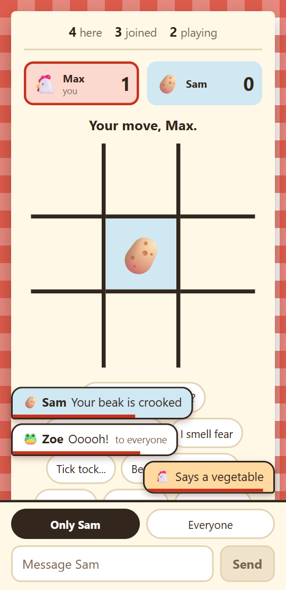
</div>

Messages delete themselves:

- A message disappears 15 seconds after your phone shows it. The red line is the countdown.
- Your own message stays marked *unseen* until everyone has seen it. Then its 15 seconds start.
- Tap a message to remove it from your screen sooner.

The ESP32 erases each message once everyone has seen it, and after 60 seconds at the latest. Nothing is saved to flash, but the WiFi is open and unencrypted, so don't send secrets.

### Stuck on the loading screen?

| Problem | Try this |
| :-- | :-- |
| The game did not open | Open `http://4.3.2.1` in a browser |
| The phone says the WiFi has no internet | Choose to stay connected |
| The page still does not load | Turn off mobile data |


## Insert coin

You need an ESP32 dev board and a USB cable that carries data.

###  PlatformIO

```sh
pio run -t upload
```

Run it in this folder. It downloads the libraries for you.

###  Arduino IDE

1. In the Library Manager, install **Async TCP** and **ESP Async WebServer**, both by ESP32Async.
2. Open `wifi-tic-tac-toe.ino`. Its folder has to be called `wifi-tic-tac-toe` too.
3. Choose **ESP32 Dev Module** and upload.

### Boot message

Open the serial monitor at 115200 baud and reset the board:

```text
Join the WiFi "Play Tic-Tac-Toe". Game: http://4.3.2.1/
```


## Dares

The ESP32 picks one of these for the loser:

| # | Dare |
| --: | :-- |
| 1 | Cluck like a chicken for 10 seconds. |
| 2 | Talk like a robot until the next game ends. |
| 3 | Compliment the winner's shoes. Sincerely. |
| 4 | Do five jumping jacks in slow motion. |
| 5 | Sing the next thing you say. |
| 6 | Announce proudly: "I lost to a Potato." (or whoever beat you) |
| 7 | Walk like a penguin to the nearest wall and back. |
| 8 | Give a 10-second acceptance speech for losing. |
| 9 | Use your hand as a phone and order a pizza. |
| 10 | Find a wall and apologise to it. |


## Cheat codes

| Unlock | Where |
| :-- | :-- |
| A different WiFi name, or fewer devices | top of `wifi-tic-tac-toe.ino` |
| New fighters, taunts and dares | lists at the start of the script in `page.h` |
| Rules and timeouts | `game.h` |
| How long chat messages stay | `MESSAGE_MS` in `page.h` (after being seen, plus the `15s` in the `.msg i` style) and in `game.h` (if never seen) |

> [!TIP]
> If you add or remove fighters, taunts or dares, change the matching counts at the top of `game.h`. The same goes for `NAME_BYTES` and `MESSAGE_BYTES`, the longest name and chat message.

### Under the hood

<div align="center">
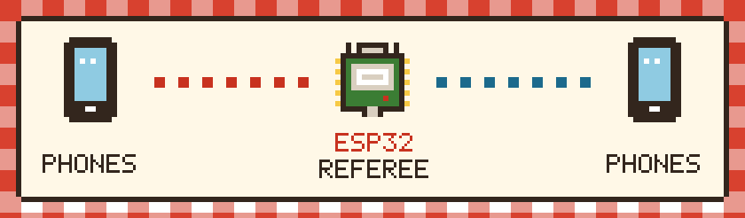
</div>

The ESP32 is the referee. Phones only ask for a move, and the board decides whether it counts. It tells players apart by the IP address it gave them, so reloading the page keeps your place. Every domain name leads to the game, which is what makes phones show the sign-in page.

```text
wifi-tic-tac-toe/
├── wifi-tic-tac-toe.ino   WiFi hotspot and web server
├── game.h                 lobby, chat and rules, plain C++ with no Arduino code
├── page.h                 the whole game page in one string
├── platformio.ini         build settings
└── docs/                  pixel art, screenshots and trailer for this README
```

<div align="center">
<br>
</div>
